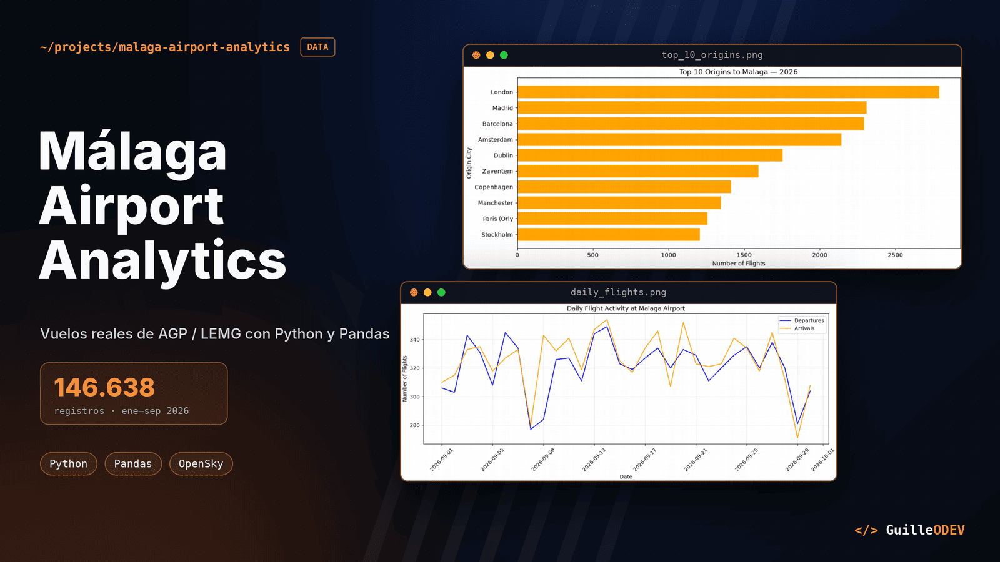
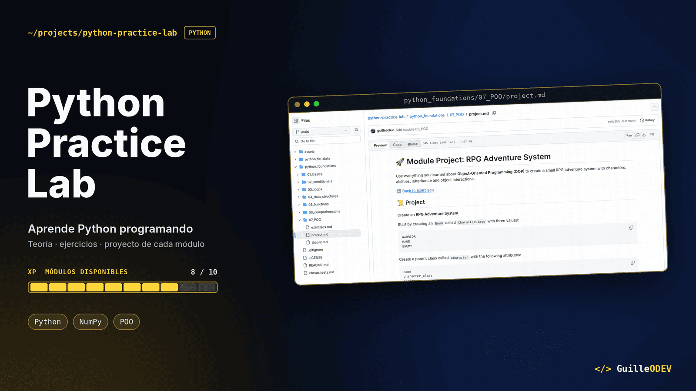
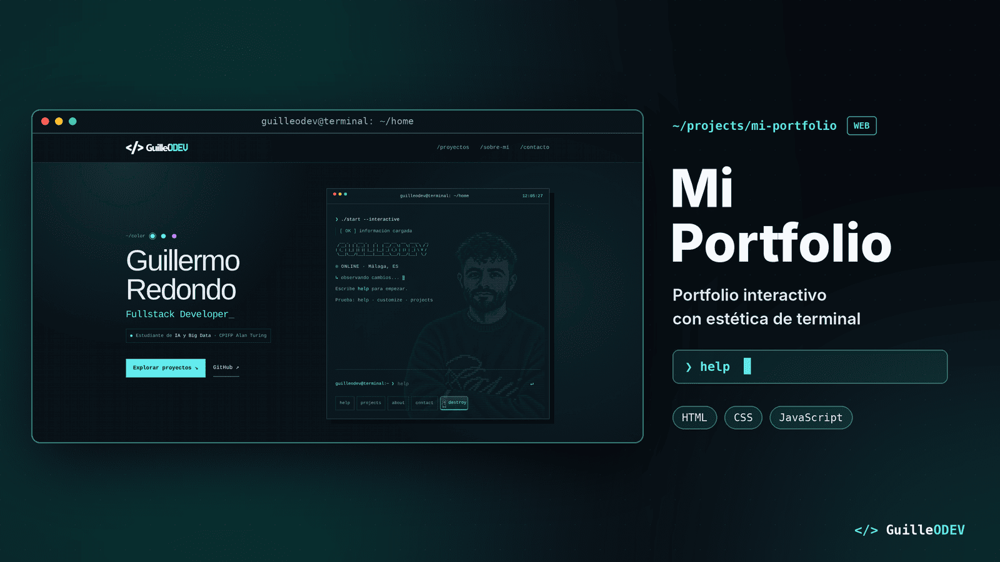
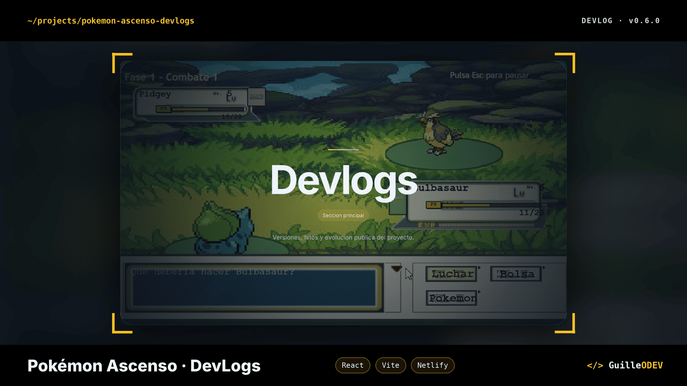
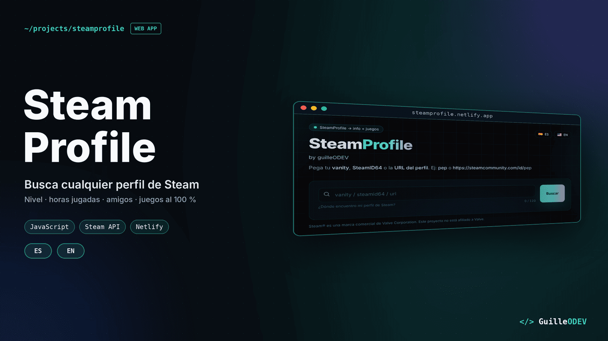
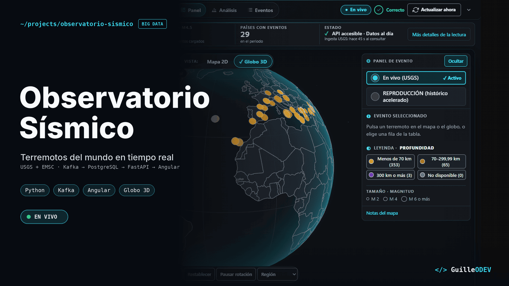
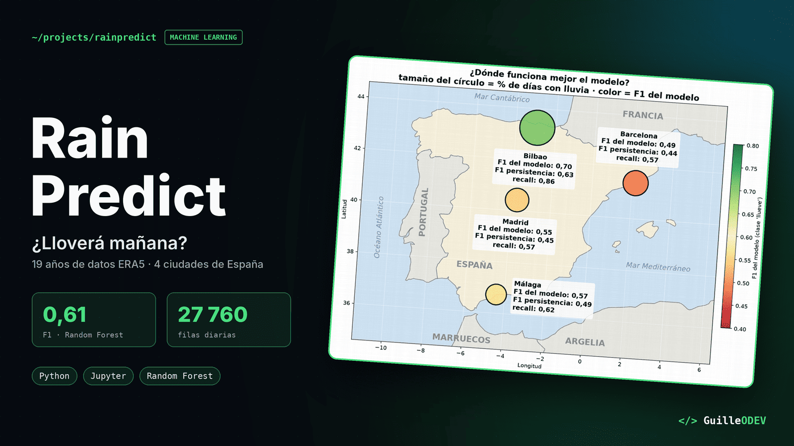
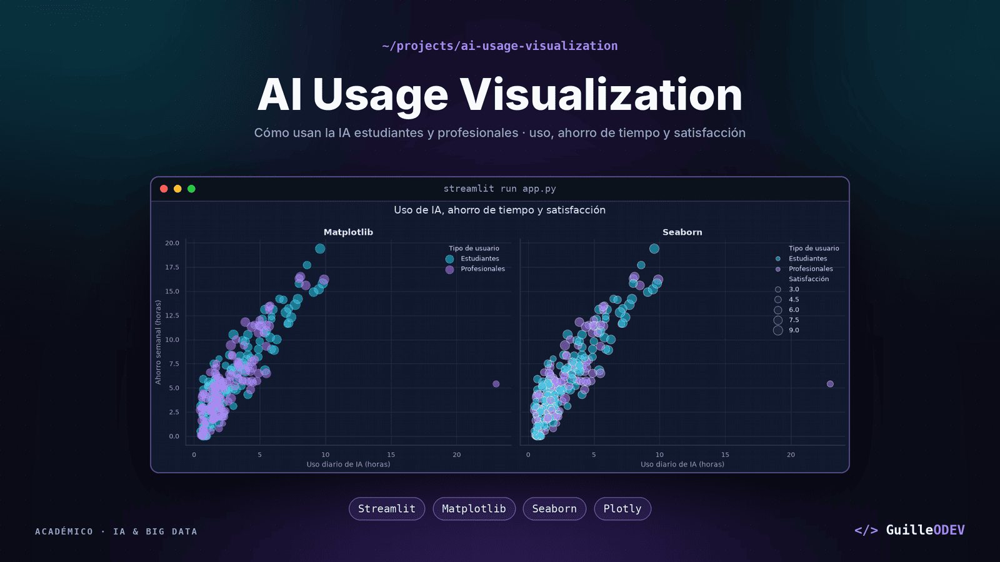
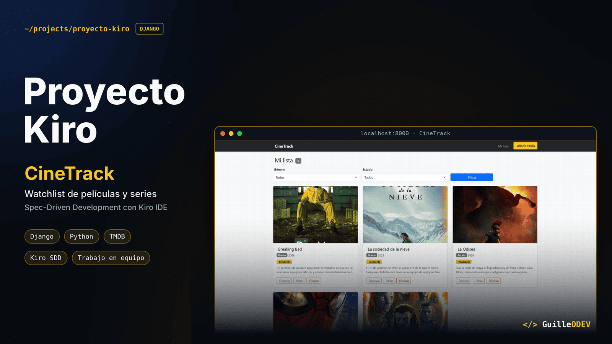

pas
## `$ ./guilleodev.sh`

```text
 ██████╗ ██╗   ██╗██╗██╗     ██╗     ███████╗ ██████╗ ██████╗ ███████╗██╗   ██╗
██╔════╝ ██║   ██║██║██║     ██║     ██╔════╝██╔═══██╗██╔══██╗██╔════╝██║   ██║
██║  ███╗██║   ██║██║██║     ██║     █████╗  ██║   ██║██║  ██║█████╗  ██║   ██║
██║   ██║██║   ██║██║██║     ██║     ██╔══╝  ██║   ██║██║  ██║██╔══╝  ╚██╗ ██╔╝
╚██████╔╝╚██████╔╝██║███████╗███████╗███████╗╚██████╔╝██████╔╝███████╗ ╚████╔╝
 ╚═════╝  ╚═════╝ ╚═╝╚══════╝╚══════╝╚══════╝ ╚═════╝ ╚═════╝ ╚══════╝  ╚═══╝

```bash
guilleodev@github:~$ python profile.py

  Name       Guillermo Redondo
  Location   Málaga, España
  Background Web Development
  Studying   Artificial Intelligence & Big Data
  Focus      Python · Data Analytics · Web Development
  Status     Building, learning, improving...
```

<pre>
  ──────────────────────────────────────────────
  <b>01.</b>  PORTFOLIO   <a href="https://guilleodev.netlify.app">guilleodev.netlify.app ↗</a>
  <b>02.</b>  LINKEDIN    <a href="https://www.linkedin.com/in/guillermo-redondo-camacho">guillermo-redondo-camacho ↗</a>
  <b>03.</b>  EMAIL       <a href="mailto:guillerc18@gmail.com">guillerc18@gmail.com ↗</a>
  ──────────────────────────────────────────────
</pre>

## `$ ls ~/projects/personal/`

<sub>Personal Projects · Web Development & Data Analytics</sub>

<table>
<tr>
<td width="50%" align="center">
  <a href="https://github.com/guilleodev/malaga-airport-analytics">
    
    <br>
    <b>✈️ Málaga Airport Analytics</b>
  </a>
  <br>
  <sub>Exploratory data analysis of real-world aviation data using Python and Pandas.</sub>
</td>

<td width="50%" align="center">
  <a href="https://github.com/guilleodev/python-practice-lab">
    
    <br>
    <b>🐍 Python Practice Lab</b>
  </a>
  <br>
  <sub>Python exercises, challenges and learning experiments.</sub>
</td>
</tr>

<tr>
<td width="50%" align="center">
  <a href="https://guilleodev.netlify.app">
    
    <br>
    <b>🌐 Mi Portfolio</b>
  </a>
  <br>
  <sub>Interactive developer portfolio with a terminal-inspired design.</sub>
</td>

<td width="50%" align="center">
  <a href="https://github.com/guilleodev/PokemonAscensoDevLogs">
    
    <br>
    <b>🎮 Pokémon Ascenso DevLogs</b>
  </a>
  <br>
  <sub>Web development diary documenting a Pokémon-inspired videogame.</sub>
</td>
</tr>

<tr>
<td width="50%" align="center">
  <a href="https://github.com/guilleodev/steamProfile">
    
    <br>
    <b>🎯 Steam Profile</b>
  </a>
  <br>
  <sub>Web application for exploring Steam profiles and player statistics.</sub>
</td>

<td width="50%" align="center">
  <a href="https://github.com/guilleodev/safe-routes-malaga-showcase">
    
    <br>
    <b>🏆 Safe Routes</b>
  </a>
  <br>
  <sub>La ruta con más luz para volver a casa de noche. Primer premio Impact Makers 2026.</sub>
</td>
</tr>
</table>

## `$ ls ~/projects/academic/`

<sub>🎓 Academic Projects · AI & Big Data · 2026/27</sub>

<table>
<tr>
<td width="50%" align="center">
  <a href="https://github.com/guilleodev/observatorio-sismico">
    
    <br>
    <b>🌍 Observatorio Sísmico</b>
  </a>
  <br>
  <sub>Real-time seismic monitoring with Python, Angular and Kafka.</sub>
</td>

<td width="50%" align="center">
  <a href="https://github.com/guilleodev/rainpredict-machine-learning">
    
    <br>
    <b>🌧️ RainPredict</b>
  </a>
  <br>
  <sub>Next-day rainfall prediction using Machine Learning.</sub>
</td>
</tr>

<tr>
<td width="50%" align="center">
  <a href="https://github.com/guilleodev/visualizacion-uso-ia-estudiantes-profesionales">
    
    <br>
    <b>📊 AI Usage Visualization</b>
  </a>
  <br>
  <sub>Interactive dashboard exploring AI usage and productivity.</sub>
</td>

<td width="50%" align="center">
  <a href="https://github.com/guilleodev/Proyecto_Kiro">
    
    <br>
    <b>🎬 Proyecto Kiro · CineTrack</b>
  </a>
  <br>
  <sub>Collaborative Django project using Spec-Driven Development.</sub>
</td>
</tr>
</table>

## `$ cat about_me.md`

Currently studying **Artificial Intelligence and Big Data**, working on projects involving real-world data, data analysis, and turning information into useful insights. I hold a degree in **Web Application Development**, with experience building websites and web applications.

```bash
$ translate about_me.md --lang es
```

*Actualmente estudiando **Inteligencia Artificial y Big Data**, desarrollando proyectos en los que trabajo con datos reales, realizo análisis y exploro cómo transformar la información en resultados útiles. Soy desarrollador titulado en **Desarrollo de Aplicaciones Web**, con experiencia desarrollando páginas web y aplicaciones.*

## `$ cat tech_stack.txt`

**Data & AI**

<p>
  
  &nbsp;
  
  &nbsp;
  
  &nbsp;
  
  &nbsp;
  
</p>

**Web Development**


**Development Tools**


## `$ cat currently_learning.txt`

```yaml
current_focus:
  - Artificial Intelligence
  - Big Data & Data Analytics
  - Python for Data Science
  - Machine Learning fundamentals

approach: "Learn by building."
```

## `$ git status`

```bash
On branch main

Changes in progress:
  + Learning new technologies
  + Exploring real-world datasets
  + Building personal projects

nothing to commit, always something to learn.
```
  
